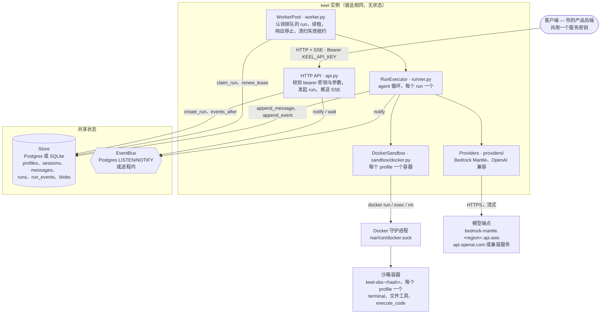
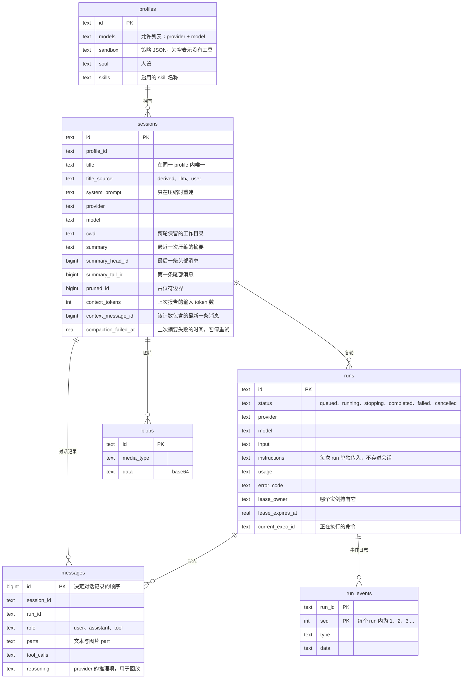
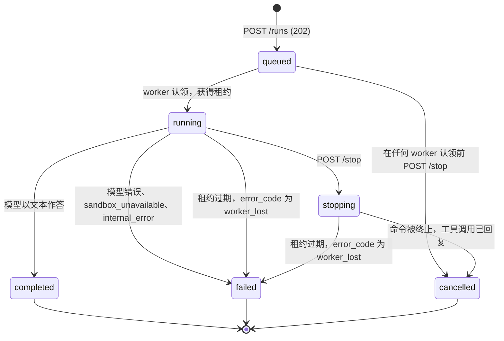
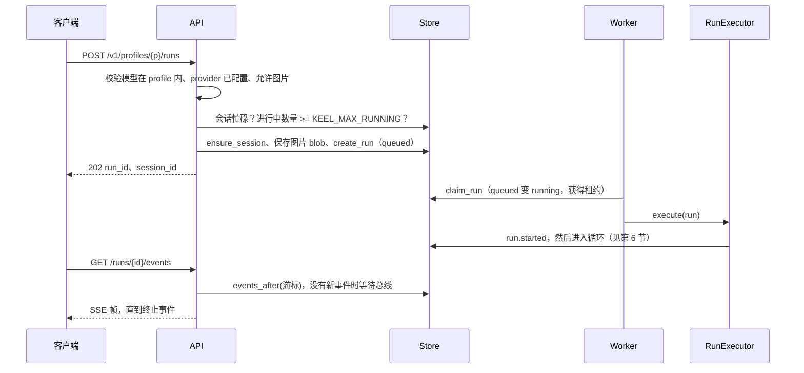
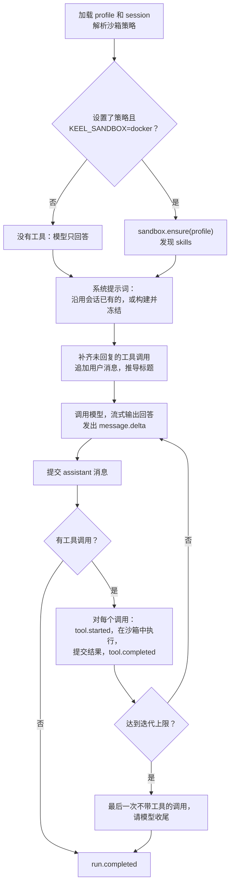
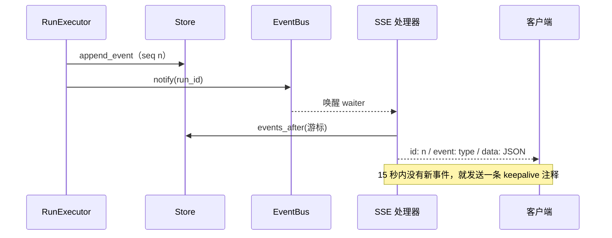
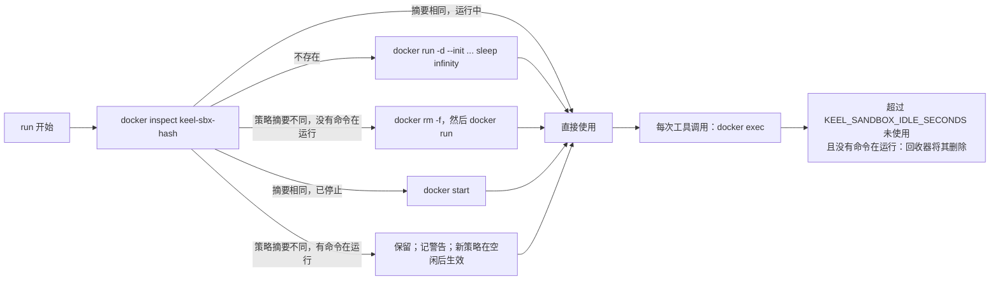
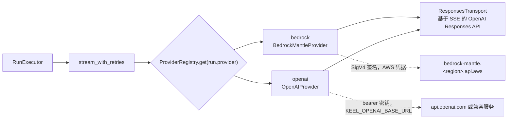
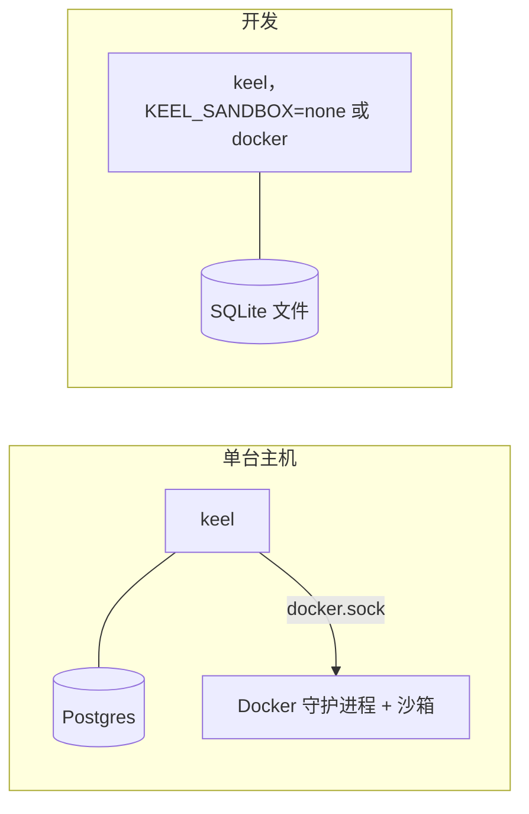

# 架构

> English version: [architecture.md](architecture.md)。两份文档内容保持一致，修改时请同步更新。

本文描述 agent-keel 当前的实现：一个无状态的 HTTP 服务，负责运行 agent 循环。客户端发起一次 **run**（一次运行）；
worker 认领它，调用模型，把模型要求的工具放进该 profile 专属的 Docker 沙箱里执行，并把每一步都写入数据库；客户端
则以可重放的事件流跟踪这次运行。任意数量的相同实例可以共用一个 Postgres 数据库（目前适用的单实例限制见
[§15](#15-已知限制)）。

本文解释各部分如何协作。使用方法请看[各指南](guide/quickstart.md)；设计背后的理由请看
[design/2026-10-11-architecture.md](design/2026-10-11-architecture.md) 和
[design/2026-10-12-m2-agent-loop.md](design/2026-10-12-m2-agent-loop.md)。

---

## 1. 系统视图

三点需要记住：

- **数据库是唯一的共享状态。** 每个 run、消息和事件都是一行记录。实例不持有任何“重启就会丢、而客户端又能看到”的东西。
- **总线不传数据。** 它只表示“run X 有新内容”或“停止 run X”，让读取方知道何时再去查一次存储。
- **Docker socket 等同于宿主机 root。** keel 通过它启动和删除沙箱容器，见 [§14](#14-安全模型)。

---

## 2. 代码地图

全部位于 `src/keel/`。

| 模块 | 作用 |
|---|---|
| `service.py` | 根据 `Settings` 组装服务：存储、总线、provider、沙箱后端、执行器、worker 池、API。负责启动（清理遗留沙箱）和关闭。 |
| `config.py` | `Settings.from_env()`；校验每个 `KEEL_*` 变量，配置有误时立即报错。 |
| `api.py` | FastAPI 应用：认证中间件、路由、错误信封、SSE 流。 |
| `worker.py` | `WorkerPool`：认领、续租、处理停止、租约清扫、关闭时排空。 |
| `runner.py` | `RunExecutor`：agent 循环，以及取消和失败的清理路径。 |
| `compress.py`、`compactor.py` | 上下文压缩：纯函数部分（估算、边界、请求组装和摘要输入）；以及 run 何时压缩、存储什么。 |
| `models.py` | 与 provider 无关的类型：`Message`、各类 part、`ToolCall`、`ModelRequest`、`Usage`、模型事件。 |
| `store/` | 基于 `Db` 适配器的 `Store`：`sql.py`（两种方言的全部查询）、`db.py`（SQLite）、`postgres.py`。 |
| `events.py` | `InMemoryEventBus`、`PostgresEventBus`。 |
| `providers/` | `ModelProvider` 接口、注册表、重试策略、Responses API 传输层、Bedrock（SigV4）、OpenAI。 |
| `sandbox/` | `SandboxBackend`：策略解析、Docker 后端、供测试用的宿主进程后端。 |
| `tools/` | 八个工具，以及循环调用的唯一入口 `run_tool`。 |
| `prompt.py`、`prompts/` | 会话的系统提示词，以及提示词和工具定义文本。 |
| `skills.py` | 通过沙箱发现 skill，并生成提示词里的索引。 |
| `titles.py` | 推导会话标题。 |

只有存在多个实现的地方才定义接口：`Store`（SQLite、Postgres）、`EventBus`（进程内、Postgres）、
`ModelProvider`（Bedrock、OpenAI，以及测试用的 fake）、`SandboxBackend`（Docker、本地）。其余都是具体代码。

---

## 3. 数据模型

由 schema 保证的规则：

- **每个会话同时只有一个进行中的 run。** `runs(session_id)` 上有一个部分唯一索引，条件是 `status` 为 `queued`、
  `running` 或 `stopping`。对忙碌的会话再次发起 run 会被拒绝（`409 session_busy`）；即使两个请求同时到达，
  这个索引也能保证规则成立。
- **标题在同一 profile 内唯一。** `sessions(profile_id, title)` 上有一个部分唯一索引，条件是标题已设置。
- **一个会话只属于一个 profile。** 当会话 id 已存在于另一个 profile 名下时，`ensure_session` 返回
  `404 session_not_found`。
- **事件按 run 编号。** `(run_id, seq)` 是主键；`append_event` 在事务内取 `MAX(seq) + 1`，遇到唯一约束冲突最多重试三次。

同一套 SQL（`?` 占位符）同时跑在 SQLite 和 Postgres 上。schema 在启动时由编号迁移（`store/migrations.py`）
创建和升级：每个迁移在自己的事务里、持有 Postgres advisory lock 执行，多个实例同时启动时只会迁移一次。0.2.0 的
数据库会原地升级；由更新版本 keel 写入的数据库会被拒绝。

---

## 4. Run 的生命周期

`finish_run` 只会更新仍处于 `queued`、`running` 或 `stopping` 的行，并返回是否更新成功。因此，一个在被停止或被
清扫的同一时刻恰好完成的 run，只会结束一次，也只有胜出的那一方会发出终止事件。

### 发起一次 run

当请求无法运行时，会在写入任何内容之前就被拒绝：模型未知、provider 未配置、把图片发给不支持视觉的模型、会话忙碌，
或达到进行中数量上限（`429 at_capacity`，带 `Retry-After: 1`）。被拒绝的 run 不会留下空会话，也不会留下孤立的 blob。

---

## 5. Worker、租约与恢复

`WorkerPool` 启动 `KEEL_WORKERS` 个 worker 循环和一个清扫器。

**认领。** `claim_run` 是一条 `UPDATE … WHERE id = (SELECT … WHERE status = 'queued' ORDER BY created_at LIMIT 1
FOR UPDATE SKIP LOCKED)`。在 Postgres 上，各实例不会认领到同一个 run。worker 找不到任务时休眠 0.5 秒（或等到
总线唤醒）；数据库出错时，循环最多退避到 10 秒，而不是每次轮询都打日志。

**租约。** 认领时把 `lease_expires_at` 设为当前时间加 `KEEL_LEASE_SECONDS`（30 秒）。run 执行期间，worker 每过
租约的三分之一就醒来，重新读取 run 并续租。只有租约的持有者、且 run 仍为 `running` 或 `stopping` 时，续租才会成功。

**停止。** `POST …/stop` 会立刻取消 `queued` 的 run（并发出 `run.cancelled`），或把 `running` 的 run 改为
`stopping` 并通知键 `stop:<run_id>`。worker 通过这次唤醒或下一次续租发现它，取消执行器任务，其余交给执行器的取消
路径：终止沙箱里正在运行的命令、关闭未结束的工具调用、为每个没有结果的工具调用写入“已取消”结果，最后把 run 结束为
`cancelled`。

**worker 死亡。** 清扫器每隔一个租约周期运行一次，把租约已过期的 `running` 或 `stopping` run 标记为 `failed`，
`error_code` 为 `worker_lost`，由最先清扫到的那个实例完成。如果某个 worker 的续租一直失败到自身的截止时间，就把该
run 交给清扫器处理。

**关闭。** worker 池停止认领，给进行中的 run 4 秒时间完成，剩下的标记为 `worker_lost`（而不是 `cancelled`，
`cancelled` 是用户主动停止的样子）。服务此时不清理任何容器：遗留的沙箱容器在下次启动时清理。

**始终有效的对话记录。** 被清扫、崩溃或中途被打断的 run，可能留下带有工具调用但没有结果的 assistant 消息，
而模型 API 会拒绝这样的请求。每一轮开始时，执行器都会找出这类调用并为每个调用写入“已取消”结果，
所以下一次请求中的每个调用总是有对应的结果。

---

## 6. Agent 循环

`RunExecutor._loop`（在 `runner.py` 中）就是整个 agent：

值得了解的特性：

- **每一步都先提交，再进行下一步。** 模型结束时写入 assistant 消息；每个工具结果在下一次调用之前写入。
  即使 worker 死亡，对话记录也能保持到最后一步为止的一致性。
- **工具失败不会终止 run。** 参数错误、沙箱消失或工具内部的异常，都会变成模型可以读到的错误结果。只有取消会被向上传递。
- **迭代上限是软着陆。** 到达 `KEEL_MAX_ITERATIONS`（60）时，循环再发起一次不带工具的调用，并附加一条请模型总结的
  要求，让用户得到答案而不是错误。这条要求不会被存储。
- **推理项会被回放。** provider 的推理项存放在 assistant 消息上，并按 provider 期望的顺序回传。若 provider 拒绝
  它们（`invalid_reasoning`），会去掉推理项重试一次。
- **长会话会原地压缩。** 每次调用模型之前，循环会估算请求的大小：provider 为上一次调用报告的输入 token 数，加上
  对更新消息的启发式估算（每个 ASCII 字符算四分之一个 token，其他字符各算一个）。达到上下文窗口的
  `KEEL_COMPRESSION_THRESHOLD`（0.75）时，最近尾部之前超过 200 个字符的工具结果和图片会被替换成一行占位符，那里的
  推理项也会被丢弃。如果这还不够（用启发式估算判断；provider 计得更多时按比例放大），就发起一次摘要调用来浓缩
  中间部分，请求随之变成开头几条消息（每条截到约 4,000 个 token）、摘要和尾部。调用以 `context_overflow` 失败时也会这样做一次，然后重试该调用。存储的内容不会被删除：`GET …/messages` 返回
  完整的对话记录，会话只记录摘要及其边界。系统提示词在压缩时重建，在下一次压缩之前逐字节复用。摘要调用失败或在
  输出上限处被截断时不会被存储，阈值触发要在 10 分钟之后才会重试。
- **工作目录跟随会话。** `terminal` 会报告命令结束时所在的目录；执行器把它保存在会话上，下一轮从那里开始。
- **skills 列表有缓存**：按（profile、策略摘要、启用的 skills）缓存 60 秒；空结果不缓存，因为它可能是一次失败的列举。

### 失败映射

| 发生的情况 | run 结束为 | `error_code` |
|---|---|---|
| provider 未配置 | `failed` | `bad_request` |
| 模型调用失败（重试之后） | `failed` | provider 的错误码：`auth`、`rate_limited`、`server_error`、`timeout`、`context_overflow`、`invalid_reasoning`、`bad_request` |
| 沙箱策略无效，或容器无法创建或访问 | `failed` | `sandbox_unavailable` |
| 意外异常 | `failed` | `internal_error`（清理仍会终止命令并回复未结的工具调用） |
| 用户停止 | `cancelled` | 无 |
| worker 死亡或关闭 | `failed` | `worker_lost` |

---

## 7. 事件与流式传输

run 的每一次状态变化都是 `run_events` 中的一行。事件类型有 `run.started`、`message.delta`、`tool.started`、
`tool.completed`、`run.completed`、`run.failed` 和 `run.cancelled`；最后三个是终止事件。

- **重放不花额外代价。** 客户端用 `?after=<上一个 seq>` 重连；处理器从存储读取，所以不会丢事件，
  也不会因为断开连接而让某个队列被分离。
- **读取与等待之间没有竞态。** 处理器在读取存储*之前*先取得 waiter，所以夹在中间的 notify 不会丢失。
- **会等待终止事件。** run 行会比它的终止事件稍早一点变为终止状态；流在关闭前最多等待 5 秒来等这个事件。
- **唤醒只是辅助。** notify 失败只记录日志，不会抛出；读取方还会按超时重新读取存储，所以 notify 丢失的最坏后果只是延迟。

### 总线

`InMemoryEventBus` 是以 run id（以及 `stop:<run id>`）为键的 `asyncio.Event` 字典，服务于单个实例和测试。
`PostgresEventBus` 在其上增加了在一个通道（`keel_events`，键作为负载）上的 `LISTEN`/`pg_notify`，所以一个实例上的
notify 可以唤醒另一个实例上的读取方。它需要两个直连（一个监听，一个发送）；事务模式的连接池（例如 RDS Proxy）
会固定或丢弃 `LISTEN`。如果监听连接丢失，它会记录一条错误，跨实例的唤醒退回到轮询（见 [§15](#15-已知限制)）。

---

## 8. 沙箱

只有当 profile 的 `sandbox` 策略非空，**并且**服务以 `KEEL_SANDBOX=docker` 运行时，profile 才有工具。
策略为空或 `KEEL_SANDBOX=none` 时，run 就是普通聊天：模型作答，但没有工具。

### 策略

通过 `PUT /v1/profiles/{id}` 设置并在那里校验，在 run 开始时再校验一次。只接受下列键，其他任何键都会返回
`400 invalid_input`。

| 键 | 含义 |
|---|---|
| `image`、`workdir` | 必填。要运行的镜像和起始目录。 |
| `runtime` | `runc`（默认）、`runsc`（gVisor）或 `kata`。 |
| `network` | 要加入的已有 Docker 网络；不填则使用 Docker 默认网络。 |
| `mounts` | `{source, target, read_only}`。设置了 `KEEL_SANDBOX_MOUNT_ROOT` 时，每个 `source` 都必须在它之下。 |
| `env` | 容器的环境变量。 |
| `user` | 以 `uid[:gid]` 身份运行。 |
| `cpus`、`memory_mb`、`pids_limit` | 资源限制。 |
| `skills_path` | 容器内存放 skills 的目录。 |

### 每个 profile 一个容器

- **名称与标签。** 容器名是 `keel-sbx-` 加上 `sha256(deployment \0 profile)` 的前 12 位十六进制字符。
  标签 `keel.managed=1`、`keel.deployment`、`keel.profile` 和 `keel.policy`（策略摘要）让 keel 能找到、比较并清理
  属于它自己的容器，而不会碰别人的。
- **同一 profile 的各会话共用它的容器。** 容器是按 profile 的，不是按会话或按 run。keel 为每个会话记录一个
  工作目录，但不会在容器内把一个会话与另一个会话隔离开；如果这很重要，请为每个租户使用一个 profile。
- **空闲回收。** 后台任务每 60 秒运行一次，删除闲置达到 `KEEL_SANDBOX_IDLE_SECONDS`（默认 30 分钟）且没有命令在
  运行的容器。下一次 run 会重新创建。
- **遗留容器。** 启动时，`remove_orphans` 会删除所有带有本部署标签的容器。这只在只运行一个实例时才安全
  （见 [§15](#15-已知限制)）。
- **终止命令。** 停止 run 时，会终止容器内该命令的进程组：先 `TERM`，等 3 秒宽限期，再 `KILL`，最后连
  `docker exec` 客户端本身也杀掉。只杀客户端会让命令继续运行。当前命令的 id 保存在 `runs.current_exec_id` 中，
  供终止时使用。
- **密钥不出现在命令行。** 策略里的 `env` 通过一个私有的临时 `--env-file` 传入（权限 0600，位于 0700 目录，用完
  立即删除），所以这些值不会出现在 `ps` 里。

### 加固

每个容器启动时都带有 `--cap-drop ALL`，只加回 `DAC_OVERRIDE`、`CHOWN` 和 `FOWNER`；`--security-opt
no-new-privileges`；`--init`；以及 `/tmp`（512 MB，`nosuid`）、`/var/tmp` 和 `/run` 的 tmpfs。CPU、内存和 PID
限制以及 OCI runtime 来自策略。

`sandbox/local.py` 把命令作为普通宿主进程运行。它不提供任何隔离，仅用于测试和本地开发。

---

## 9. 工具

profile 有沙箱时，会提供八个工具；它们的 schema 位于 `prompts/tools/*.json`。

| 工具 | 作用 | 限制 |
|---|---|---|
| `terminal` | 运行 shell 命令；报告退出码和命令结束时所在的目录。 | 默认超时 180 秒，最长 600 秒。 |
| `execute_code` | 运行 Python 脚本。 | 300 秒。 |
| `read_file` | 带行号读取，支持 `offset` 和 `limit`；拒绝二进制文件。 | 最多读 10 MiB、2000 行，每行最多 2000 个字符。 |
| `write_file` | 写文件，并创建父目录。 | |
| `patch` | 把 `old_string` 替换为 `new_string`；匹配必须精确且唯一。 | |
| `search_files` | 内容搜索（模式：内容、仅文件名、计数；可选上下文行和文件 glob）或文件搜索；镜像里有 `rg` 时用 `rg`，否则用 `grep`/`find`。跳过隐藏目录，用 `rg` 时还跳过被 `.gitignore` 忽略的文件；无结果时若隐藏或被忽略的文件里有匹配，会给出提示。 | 默认 50 条结果。 |
| `skills_list`、`skill_view` | 列出已启用的 skills；读取其中一个。 | |

通用行为（`tools/base.py`）：

- **唯一入口。** `run_tool` 查找工具、解析 JSON 参数、执行，并把每一种失败变成错误结果。未知工具、错误的 JSON、
  沙箱错误和意外异常，都会变成模型可以据此行动的文本。
- **脱敏。** 输出在模型看到之前，会先清除常见的密钥形态（私钥块、provider 令牌、`user:password@` 形式的 URL）。
- **结果有上限。** 超过 100 000 个字符的结果会被缩短，同时仍然保持是合法的 JSON。
- **预览。** 每次调用都有一个简短的预览（`tool.started` / `tool.completed`），客户端无需完整参数就能展示进度。

### Skills

skill 是一个带有 `SKILL.md` 的目录，其 front matter 包含名称和描述。keel **通过沙箱**从策略的 `skills_path` 读取
它们（部署时把它们放进镜像或挂载进来，只读），保留该 profile 启用的那些，并把索引（分类、名称、截断到 60 个字符的
描述）放进系统提示词。只有在需要时，模型才会用 `skill_view` 加载某个 skill 的完整内容。

---

## 10. 系统提示词

每个会话**只构建一次**（只在压缩时重建，见 §6），保存在 `sessions.system_prompt` 里，所以之后每一轮发送的前缀都
逐字节相同，这正是 provider 端提示词缓存能起作用的前提。顺序如下，稳定的内容在前：

1. **身份** — profile 的 `soul`，或 `You are a helpful assistant.`
2. **指导**与**平台**文本（工具使用和环境规则）。
3. **Skills** 的页眉、索引和页脚（有 skills 时）。
4. **易变的上下文** — 对话开始的日期、模型和 provider。
5. **环境** — 工作目录。

没有工具时，提示词只有身份这一部分。每次 run 的 `instructions`（客户端随每次 run 发送的文本）是模型请求中的独立字段，
不会改变已存储的提示词；provider 会把它追加在系统提示词之后。提示词缓存的键是会话 id、系统提示词和工具定义的哈希，
不包含每次 run 的 instructions，所以每次都不同的 instructions 不会破坏已缓存的前缀。

---

## 11. 模型 provider

provider 实现两件事：`capabilities(model)`（上下文窗口、视觉、推理回放、并行工具调用、提示词缓存方式）和
`stream(request)`，后者依次产出 `TextDelta`、`ToolCallReady`、`ReasoningReady`，最后是带 `Usage` 的 `Completed`。
provider 的失败只会以 `ModelError` 的形式出来，错误码共七种，所以 provider 之上的代码都不依赖任何厂商的错误类型。

- **`bedrock`** 始终注册：Bedrock Mantle 上的 OpenAI 系列模型，使用常规 AWS 凭据链做 SigV4 签名；上下文 272k，
  支持视觉和推理回放，按 key 缓存提示词。
- **`openai`** 在设置了 `KEEL_OPENAI_API_KEY` 时注册：bearer 认证，`KEEL_OPENAI_BASE_URL` 用于兼容服务，
  `KEEL_OPENAI_COMPAT=1` 用于去掉严格服务端会拒绝的请求字段，`KEEL_OPENAI_CONTEXT_WINDOW`（默认 128 000）。密钥
  以 `repr=False` 保存，会从错误文本中清除，认证错误使用固定的提示语。
- **重试**（`providers/retry.py`）：`rate_limited`、`server_error` 和 `timeout` 最多重试到三次尝试，采用指数退避
  （5 秒起，翻倍到 120 秒，带抖动；遵守 `Retry-After`，上限 600 秒）——但**只在这次调用还没有产出任何内容时**，
  因为已经发给客户端的输出收不回来。
- **新增 provider** 只需实现该协议，并在 `service.default_providers` 里注册；其他地方都不用改。

profile 可以使用哪些模型由它的允许列表（`models`）决定；run 指定了列表之外的模型会被拒绝（`400 model_not_allowed`）。

---

## 12. HTTP API

除 `/healthz` 外，全部位于 `/v1/profiles/{profile_id}` 之下。详情见 [API 指南](guide/api.md)。

| 路由 | 用途 |
|---|---|
| `PUT /` | 创建或替换 profile：`models`、`sandbox`、`soul`、`skills`。 |
| `POST /runs` | 发起 run；返回 `202` 和 `run_id`、`status`、`session_id`。 |
| `GET /runs`、`GET /runs/{id}` | 列出 run（默认 `status=active`）或读取其中一个。 |
| `POST /runs/{id}/stop` | 停止 run。 |
| `GET /runs/{id}/events?after=` | SSE 事件流。 |
| `GET /sessions`、`GET /sessions/{id}/messages`、`GET /sessions/{id}/boundary` | 列出会话；读取对话记录；最新的消息 id。 |
| `PATCH /sessions/{id}`、`DELETE /sessions/{id}` | 重命名；删除（有 run 进行中时被拒绝）。 |

**认证**使用一个共用的服务密钥：`Authorization: Bearer <KEEL_API_KEY>`，以常量时间比较。`/healthz` 不需要认证。
keel 不认识终端用户：**profile 是租户的单位**，由前面的产品把它的用户映射到 profile，并保管好这个密钥。

**错误**始终是 `{"error": {"code", "message"}}`。客户端会看到的错误码：`unauthorized`、`unavailable`、
`invalid_input`、`run_not_found`、`session_not_found`、`session_busy`、`at_capacity`（429）、`model_not_allowed`、
`provider_unavailable`、`model_not_vision_capable`、`title_in_use`。

### 会话、标题与图片

- **会话**由第一个指明它的 run 创建（否则会生成一个 id）。它们保存对话记录、系统提示词（两次压缩之间保持不变）和工作目录。
- **标题**来自第一条用户消息（清理、限长，并用 `#2` … `#9` 保证唯一），带有等级（`derived` < `llm` < `user`），
  用户设置的标题不会被低等级的标题覆盖。
- **图片**（PNG、JPEG、GIF、WebP；每个 run 最多 4 张，每张 5 MiB，在解码前先检查长度）以 blob 存储；消息里只保留
  引用，构建模型请求时才加载字节。blob 丢失时会变成文本 `[image no longer available]`。不支持视觉的模型会拒绝图片。

---

## 13. 部署形态

- **目前的生产形态：** 一个 keel 容器加 Postgres，并挂载宿主机的 Docker socket 来运行沙箱。每个沙箱加入你选定的网络；
  keel 的数据库应放在沙箱无法访问的网络上。
- **开发：** SQLite；如果不需要隔离，用 `KEEL_SANDBOX=none`（仅聊天），测试中则使用宿主进程后端。
- **横向扩展**正是这个设计的目标（无状态 worker、用 `SKIP LOCKED` 认领、跨实例唤醒），但在运行多个实例之前，
  请先看下面的限制。

配置完全由环境变量提供，启动时校验（`config.py`）；变量列表见[配置指南](guide/configuration.md)。

---

## 14. 安全模型

- **服务密钥**保护整个 API。拿到它的人可以读取所有 profile 的对话记录并发起 run。请把它放在产品的后端，
  绝不要放到浏览器里。
- **Docker socket 等同于宿主机 root。** keel 可以用策略允许的任何挂载启动任何镜像。可以这样限制：
  `KEEL_SANDBOX_MOUNT_ROOT`（挂载必须在其下）、策略只来自你自己的后端，以及加固过的守护进程（rootless Docker 或
  专用主机）。
- **沙箱是模型所运行代码的边界。** 丢弃 capabilities、`no-new-privileges`、资源限制、可选的 gVisor 或 Kata
  runtime、由你选择的网络（或不联网），以及你想要的只读挂载。沙箱不与 keel 的数据库共用网络。
- **密钥**会从工具输出中脱敏，绝不放到命令行里，OpenAI 密钥也会从错误中清除。
- **租户隔离**以 profile 为单位：每个路由都限定在路径中的 profile 内，属于其他 profile 的会话 id 会返回 404。
  这并不能防御持有服务密钥的客户端。

漏洞报告政策见 [SECURITY.md](../SECURITY.md)。

---

## 15. 已知限制

- **目前只运行一个实例。** Postgres 的 `LISTEN` 连接不会自行重连（跨实例唤醒随后退回到轮询），而且启动时的
  `remove_orphans` 会删除该部署的所有沙箱，这会破坏第二个实例上正在进行的 run。
- **尚未实现：** 长期记忆、定时任务、审批、网页搜索或浏览、MCP 服务器、agent 自己编写的 skills、Anthropic 官方
  API 的 provider。
- **Postgres 需要直连**以支持 `LISTEN`；事务模式的连接池不行。
- **1.0 之前：** API 和 schema 可能在版本之间变化（见[更新日志](../CHANGELOG.md)）。

---

## 16. 测试

`.venv/bin/python -m pytest -q` 运行时不需要 Docker、Postgres 或模型：存储跑在 SQLite 上，循环用 fake provider 和
宿主进程沙箱。可选的测试套件通过环境变量开启：

| 变量 | 增加的内容 |
|---|---|
| `KEEL_TEST_POSTGRES_DSN` | 在 Postgres 上运行的存储和事件总线测试 |
| `KEEL_TEST_DOCKER=1` | 针对真实守护进程的 Docker 沙箱（`KEEL_TEST_DOCKER_IMAGE` 指定镜像） |
| `KEEL_LIVE_BEDROCK=1` 加 `KEEL_TEST_DOCKER=1` | 一次真实的模型运行，在沙箱里调用 `terminal` |

CI 在每次推送时运行测试套件、Postgres 测试、Docker 沙箱测试和镜像构建。
